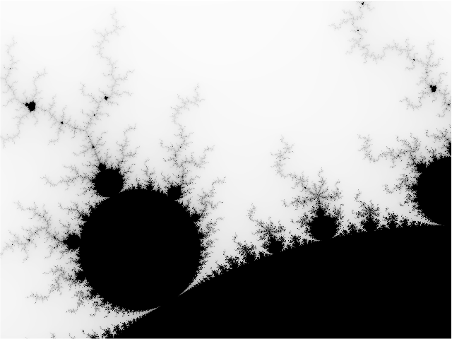

# Mandelbrot in Typescript

This repository contains a [Typescript](https://www.typescriptlang.org/) implementation for generating visualizations of the Mandelbrot set. 

It can render the Mandelbrot set directly to the terminal as ASCII art or produce a data file for `gnuplot` to generate a high-resolution PNG image.

### Other Language Implementations

This project is part of a suite of mandelbrot implementations in different languages.

Single Thread/Multi-thread shows the number of seconds it takes to do a 5000x5000 calculation.


| Language                                                       | Single Thread   | Multi-Thread | Simd | Multi-Thread + Simd |
| :------------------------------------------------------------- | ---------------:| -----------: | ----:| ------------------: |
| [Awk](https://github.com/jesper-olsen/mandelbrot-awk)          |           146.3 |              |      |                     |
| [Bash5.3](https://github.com/jesper-olsen/mandelbrot-bash)     |         10187.3 |              |      |                     |
| [Zsh](https://github.com/jesper-olsen/mandelbrot-bash)         |          2683.6 |              |      |                     |
| [Ksh (93u+m)](https://github.com/jesper-olsen/mandelbrot-bash) |          1271.5 |              |      |                     |
| [C](https://github.com/jesper-olsen/mandelbrot-c)              |             3.6 |          0.6 |  0.7 |               0.2   |
| [C++](https://github.com/jesper-olsen/mandelbrot-cpp)          |             3.7 |          0.6 |  0.7 |               0.2   |
| [Erlang](https://github.com/jesper-olsen/mandelbrot_erl)       |            35.6 |          8.3 |      |                     |
| [Fortran](https://github.com/jesper-olsen/mandelbrot-f)        |             4.5 |              |      |                     |
| [Go](https://github.com/jesper-olsen/mandelbrot-go)            |             4.1 |          0.8 |  1.3 |               0.4   |
| [Java](https://github.com/jesper-olsen/mandelbrot-java)        |             3.9 |          0.8 |  1.4 |               0.5   |
| [Lua](https://github.com/jesper-olsen/mandelbrot-lua)          |            33.2 |              |      |                     |
| [Mojo](https://github.com/jesper-olsen/mandelbrot-mojo)        |             3.8 |          1.2 |  0.7 |               0.4   |
| [Nu](https://github.com/jesper-olsen/mandelbrot-nu)            |   (est) 17186.6 |              |      |                     |
| [Odin](https://github.com/jesper-olsen/mandelbrot-odin)        |             4.4 |              |      |                     |
| [Py](https://github.com/jesper-olsen/mandelbrot-py)            |     (pure) 93.3 | (jax)    5.9 |      |                     |
| [R](https://github.com/jesper-olsen/mandelbrot-R)              |           335.0 |              |      |                     |
| [Rust](https://github.com/jesper-olsen/mandelbrot-rs)          |             4.7 |          1.3 |  1.4 |               0.8   |
| [Swift](https://github.com/jesper-olsen/mandelbrot-swift)      |             4.5 |          1.2 |  1.3 |               0.7   |
| [Tcl](https://github.com/jesper-olsen/mandelbrot-tcl)          |           306.9 |              |      |                     |
| **[Typescript](https://github.com/jesper-olsen/mandelbrot-ts)** |            4.1 |          0.8 |      |                     |
| [Zig](https://github.com/jesper-olsen/mandelbrot-zig)          |             4.9 |          0.9 |  0.7 |               0.3   |

---

## Prerequisites

You will need the following installed:

1. Node.js and npm. 
2. **Gnuplot** (required *only* for generating PNG images).

---

## Build

Run `npm install` once (installs TypeScript and @types/node).
Build with `make`, or `npx tsc`.


---

## Usage

The compiled executable can be configured via command-line arguments using a `key=value` format.

### 1. ASCII Art Output

To render the Mandelbrot set directly in your terminal, run the executable.

```sh
node dist/mandelbrot.js
```

You can change the view and resolution by passing parameters:
```sh
# Zoom in on a different area with a wider view
node dist/mandelbrot.js width=120 ll_x=-0.75 ll_y=0.1 ur_x=-0.74 ur_y=0.11
```

### 2. PNG Image Generation

To create a high-resolution PNG, you first generate a data file and then process it with `gnuplot`.

**Step 1: Generate the data file**
Set `png=1` and specify the desired dimensions. Redirect the output to a file.

```sh
node dist/mandelbrot.js png=1 width=1000 height=750 > image.dat
```

**Step 2: Run gnuplot**
This will read `image.dat` and create `mandelbrot.png`.

```sh
gnuplot topng.gp
```
The result is a high-quality `mandelbrot.png` image.



## Performance

Benchmarks were run on an **Apple M5** system with Typescript Version 7.0.2:
```sh
tsc --version
Version 7.0.2
```

**Generating a 1000x750 data file:**
```sh
time node dist/mandelbrot.js png=1 width=1000 height=750 > image.dat

real    0m0.287s
user    0m0.164s
sys     0m0.036s
```

**Generating a 5000x5000 data file:**
```sh
time node dist/mandelbrot.js png=1 width=5000 height=5000 > image.dat

real    0m4.107s
user    0m4.062s
sys     0m0.037s
```

**Generating a 5000x5000 data file with multiple worker threads:**
```sh
time node dist/mandelbrot_threaded.js png=1 width=5000 height=5000 > image.dat

real    0m0.812s
user    0m5.713s
sys     0m0.101s
```
